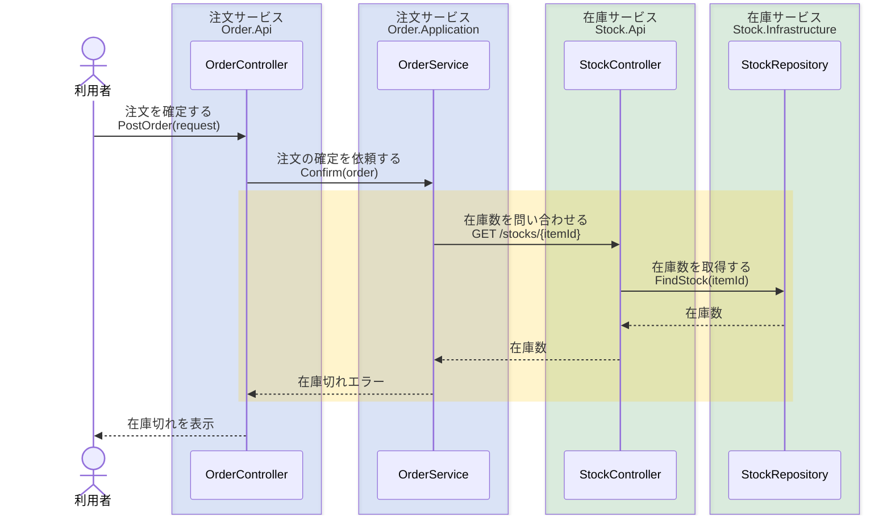

# ワークフロー共通ルール

## 目的

フェーズを順に進めるワークフロー系スキルで、共通する進め方と書式をそろえる。各スキルは、このルールにフェーズ固有の手順を加えて使う。

## 止まり方

- 1 回の応答では、1 フェーズ分の結果をまとめて出して止まる。止まる単位をスキルが別に決めている場合は、それに従う。
- 結果は通常の応答の本文に出し、質問用のツールや選択肢のボタンには入れない。そこでは Mermaid が描画されず、読みにくくなるためである。
- 毎回の応答の先頭に、`## フェーズ 2: 設計確認` のように現在のフェーズを書く。質問や指摘に答える応答でも書く。どこまで進んだかを応答ごとに分かるようにするためである。
- 次へ進むかどうかを選択肢で聞かない。結果の最後に「問題なければ「次」と入力してください。フェーズ 3: コード確認に進みます。」のように、次に進むフェーズを添えて書いて止まる。
- 利用者が「次」と入力したら次へ進む。質問や指摘が来たら、そのフェーズにとどまって答える。「フェーズ 3 へ」のように行き先を指定されたら従う。
- 答えが必要な質問は、スキルが指定した場面に限り、選択肢で聞いてよい。

## ユーザーストーリー

ユーザーストーリーは、ファイルやクラスの単位ではなく、ユーザー体験の単位で書く。

```markdown
1. **<ストーリー名>**: 今までは<○○のユーザー体験>において<○○>だったのを、<××>にした
```

- 実装済みの変更は「にした」、これから実装する変更は「にする」で結ぶ。
- ユーザーは、その変更の影響を受ける人とする。ライブラリや API の変更なら呼び出す開発者、運用手順の変更なら運用者になる。

例:

```markdown
1. **在庫切れの通知**: 今までは注文確定の体験において在庫切れでも成功と表示されていたのを、確定前に在庫切れを知らせて確定を止めるようにした
```

## スイムレーン

ユーザーストーリーごとの処理の流れを、クラスごとのスイムレーンで描く。

- Mermaid の `sequenceDiagram` で書き、クラスを 1 レーンにする。左端は起点となるユーザーや呼び出し元にする。クラスのないコードでは、モジュールやコンポーネントをレーンにする。
- 流れが複数のプロジェクト（csproj など）にまたがるときは、プロジェクトごとのレーンを `box` で囲み、名前を `<サービス名><br/><プロジェクト名>` にする。`box` は入れ子にできないため、同じサービスの `box` は色をそろえて隣に並べ、サービスの境界を色で示す。矢印が色の境界を越える箇所で、サービス間の呼び出しが見えるようにするためである。起点のユーザーは囲まない。
- 変更後の流れを描き、今回の変更部分を `rect` で囲む。
- 呼び出しの矢印には、やることとメソッド名を `<br/>` で改行して書く。処理の意味と実際のコードの両方を図から追えるようにするためである。戻りの矢印には返す内容を書く。

例:



## ファイルへのリンク

コードやテストの位置を示すときは、ローカルファイルへのリンクを付け、該当の行を開けるようにする。

```markdown
[path/to/file:42](path/to/file:42)
```

- リンク先は作業ディレクトリからの相対パスに `:<行番号>` を付けたものにする。一時 worktree など作業ディレクトリの外のファイルは、絶対パスにする。
- 該当の箇所が複数あるときは、全箇所をリンクする。
